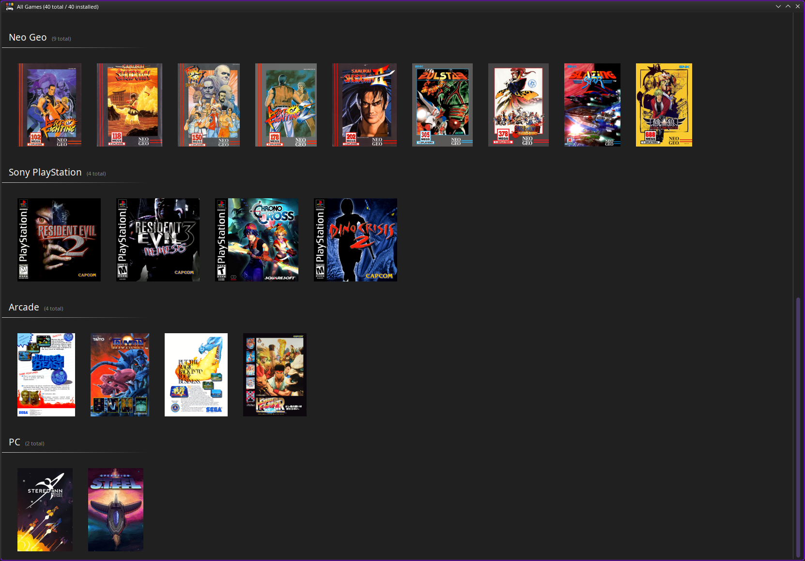

# mkGameBrowser

A Qt6 app that shows a game collection as a grouped cover overview and launches the games: emulated games via
RetroArch, PC games as native Linux programs.

mkGameBrowser is the Linux successor of an earlier AutoHotkey script ("the original" below). It keeps the
original's folder layout and file formats, so an existing collection can be used unchanged.



## Data structure

`<UserD>` is the base folder of the collection. It contains `GameBrowser/GameInfo/` (metadata and covers) and,
by default, `retroarch-roms/` (ROMs) and `Games/` (PC games).

```
<UserD>/GameBrowser/GameInfo/<Platform>/<Game>/
    GameInfo.txt        Auto_Series_STR, Auto_Name_STR, Auto_DevName_STR, Auto_System_STR,
                        Auto_Genre_STR (multiple values separated by "|"), Auto_FirstReleaseDate_STR, Private_Comments_STR
    Cover.jpg|png       case-insensitive
    Launch.conf         ROM file name (in RomsDir/<ROM subfolder>), or for "PC" the path to the Linux program:
                        absolute, "~/..." or relative to PcGamesDir; additional *.conf files possible
    Extras/, Reviews/   optional
```

New games: create the folder `GameInfo/<Platform>/<Game>/` and reload (F5).
Folders whose name starts with `_` are ignored. As in the original, a missing `GameInfo.txt` is created, an existing one is normalized (fixed key order), and a missing `Launch*.conf` is created with a placeholder.

## Usage

- **Right-click on empty space:** Group (platform, genre, series, developer, title, year, year/month),
  sort, label, hide (installed/not installed, with/without review, "All but genre/platform"),
  shade. Changes take effect immediately and are saved.
- **Right-click on a cover:** Play (one entry per `*.conf`), Edit, Folder, Extras, Reviews, Google search.
- **Double-click:** launch the game with `Launch.conf`. **Hover:** info window.
- **Ctrl+F:** filter bar at the top (as in mkFolderWidget): every word entered must occur in title, series, developer,
  platform, genre or date. Esc clears and closes it, Ctrl+Backspace clears or closes it,
  Backspace in the overview jumps back into the filter bar.
- **Keys:** A–Z/0–9 jump to the group; Page Up/Down, Home/End, arrow keys (horizontal with Shift);
  Ctrl+E/G/L for the game under the mouse; F1 help; F5 reload; Esc closes the filter bar or quits.
- **Mouse wheel:** line by line; page by page with Ctrl or the right button held; horizontal with Shift.

## Thumbnail cache

`~/.cache/mkGameBrowser/ThumbsCache<PixelHeight>/` – per game `<Platform>_<Game>.png` and `.grey.png` (darkened), plus `_List.txt` (`Marker||Width|CoverSize|CoverModificationTime`). A thumbnail is only regenerated when the size or date of the cover changes; new ones are generated in the background.

## Configuration

`~/.config/mkProjects/mkGameBrowser.conf`. The view (grouping, sorting, filters …), window geometry and scroll position are stored separately in `~/.local/state/mkProjects/mkGameBrowser_state.conf`.
On first start you are asked for the GameInfo folder (or use `mkGameBrowser --gameinfo <folder>`).

| Section      | Contents |
|--------------|----------|
| `[Paths]`    | GameInfo folder, thumbnail cache, RetroArch program and configuration, core folders, ROM and PC games folders. Empty ROM/PC entries are derived from `<UserD>` (ROMs fall back to `~/.local/share/retroarch-roms`). |
| `[Systems]`  | Mapping platform → libretro core and ROM subfolder. |
| `[Programs]` | `TextEditor`: program used to edit `GameInfo.txt` and `*.conf`, as a `.desktop` ID (e.g. `org.kde.kate.desktop`), program name or path. Empty = system default application. |

Links (Google search) always open in the default browser.

## Requirements

- Qt ≥ 6.5 (Core, Gui, Widgets, LinguistTools), CMake ≥ 3.19 and a C++ compiler
- [RetroArch](https://www.retroarch.com/) with the libretro cores listed in `[Systems]`, for emulated games

On Arch Linux:

```bash
sudo pacman -S --needed base-devel cmake qt6-base qt6-tools
sudo pacman -S --needed retroarch xdg-utils   # optional, at runtime
```

## Building and installing

```bash
git clone https://github.com/KrokusPokus/mkGameBrowser.git
cd mkGameBrowser
cmake -B build -DCMAKE_BUILD_TYPE=Release -DCMAKE_INSTALL_PREFIX=/usr
cmake --build build --parallel
sudo cmake --install build                   # installs system-wide
sudo xargs rm < build/install_manifest.txt   # uninstalls again
```

For development, `./build.sh` builds into `build/bin/` without installing, and `./build_lupdate.sh` updates the
translation sources in `i18n/*.ts`.

## License

GPL-3.0-only, see [LICENSE](LICENSE).
